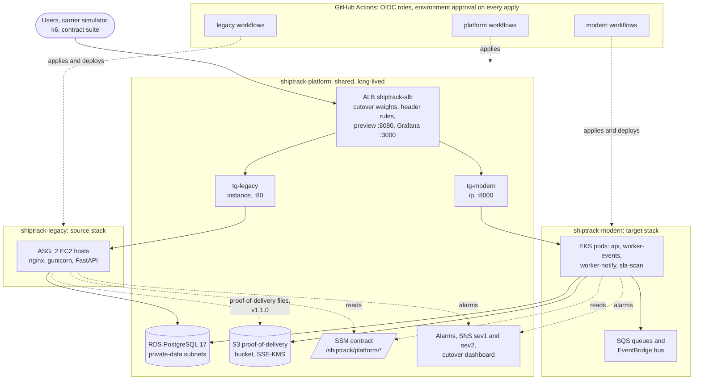
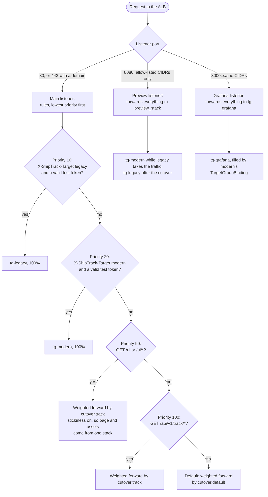

# shiptrack-legacy

ShipTrack v1.x: the source workload of the ShipTrack cloud migration. A FastAPI shipment-tracking API
with a small React tracking UI, deployed as a tarball to EC2 instances behind the platform ALB. This is
the application that the migration assesses, replatforms, and refactors onto EKS.

This repository reproduces a realistic legacy deployment on purpose, so that the migration has real
findings to assess and resolve. The sixteen anti-patterns listed in `docs/DESIGN.md` are requirements,
and each one is tagged in code with `LEGACY AP-xx`. Do not fix them here; `shiptrack-modern`, the target
workload, is where each one is remediated. The application code itself stays clean, typed, and tested.

- Design: [`docs/DESIGN.md`](docs/DESIGN.md)
- Decisions: [`docs/ADR.md`](docs/ADR.md)
- The shared infrastructure it runs on, and the cutover weights: [`shiptrack-platform`](https://github.com/loriamichaelj/shiptrack-platform)
- Detailed diagrams of all three repositories: [`ARCHITECTURE.md` in shiptrack-platform](https://github.com/loriamichaelj/shiptrack-platform/blob/dev/docs/ARCHITECTURE.md)

`v1.0.0` is the tag `shiptrack-modern` forks from. A *proof of delivery* is the document a carrier produces
when a shipment is delivered; names that stored data and the contract depend on, such as the `/pod` API
paths and the `pod_documents` table, keep the old abbreviation.

## Migration strategy

ShipTrack is a cloud migration. The workload moves from EC2 hosts behind an ALB to containers on EKS,
one wave of traffic at a time, and the same image is then taken to AKS and GKE
([`shiptrack-modern-azure`](https://github.com/loriamichaelj/shiptrack-modern-azure),
[`shiptrack-modern-gcp`](https://github.com/loriamichaelj/shiptrack-modern-gcp)). The strategy for each
part of the workload is chosen from the **7 Rs** that AWS Prescriptive Guidance defines in
[About the migration strategies](https://docs.aws.amazon.com/prescriptive-guidance/latest/large-migration-guide/migration-strategies.html):
retire, retain, rehost, relocate, repurchase, replatform, and refactor or re-architect.

**Assessment.** The source stack (`shiptrack-legacy`) carries sixteen anti-patterns on purpose
(`AP-01` to `AP-16`, listed in `docs/DESIGN.md`). Each is a finding that the assessment has to surface and the
migration has to resolve. Their classification is **replatform, then refactor**. A
rehost alone would carry the worst of them to the new platform unchanged: an in-process event queue
that loses events at a restart (`AP-06`), proof-of-delivery files on one host's disk that only sticky
routing hides (`AP-05`), and an SLA scan that runs on every host (`AP-09`).

**The seven Rs in ShipTrack**

| R | What AWS means by it | In ShipTrack |
|---|---|---|
| Retire | Decommission or archive the application | The source stack's scheduled jobs (the SLA scan and the proof-of-delivery sync) are removed in Wave 3, and its local-disk proof-of-delivery store is retired by the move to S3. The stack as a whole is not retired: it stays as the fallback |
| Retain | Keep the application in the source environment | The source stack keeps running behind the preview port as the fallback. The shared PostgreSQL database and its schema, the frozen API contract, and the source stack's original minimal UI are kept as they are |
| Rehost | Lift and shift, with no changes | Not used for the application, for the reason above. The source stack is itself the baseline that the assessment measures |
| Relocate | Move to the cloud version of the same platform, or to another VPC, Region, or account | Not used. Both stacks run in one account and one VPC and share the platform's ALB and database; the cutover moves traffic, not servers |
| Repurchase | Replace the application with a different product, usually SaaS | Not used for the application. ShipTrack is built, not bought |
| Replatform | Move to the cloud with some optimization and no change to the core architecture | EC2 hosts become containers on EKS, with immutable images by digest, rolling deploys, pod autoscaling (HPA and KEDA) on arm64 nodes, and one identity and role per workload (`REM-03`, `REM-04`, `REM-10` to `REM-12`, `REM-14`). Logs and metrics are collected by managed services (the CloudWatch Observability add-on and Amazon Managed Prometheus). On Azure and GCP the same image runs on AKS and GKE against each cloud's managed database, queue, secret store, and object storage, through the cloud seam |
| Refactor | Change the architecture to use cloud-native features | The three architectural defects are redesigned: the in-process queue becomes SQS, a worker, and EventBridge (`REM-06`); proof-of-delivery files move from host disk to S3 behind a presigned redirect (`REM-05`); and the cron job on every host becomes one CronJob with one atomic statement (`REM-09`). The application also gains credentials from Secrets Manager, real health probes, structured logs, and metrics (`REM-01`, `REM-02`, `REM-07`, `REM-08`, `REM-15`, `REM-16`) |

AWS advises refactoring in a large migration only when the other strategies are not acceptable,
because it is the most complex and costly. For one application with these three defects they were not
acceptable, so the migration replatforms the runtime and refactors only the parts that a lift could
not fix. Every refactor is its own pull request that names its `REM-xx`.

**Cutover.** Traffic moves in waves by changing weights on the platform's ALB, by pull request in
`shiptrack-platform`: Wave 0 dark launch, Wave 1 the read path and the UI, Wave 2 the write path, a
handoff of schema ownership, and Wave 3 the scheduled jobs. Both stacks answer with an
`X-ShipTrack-Stack` header, so a test that landed on the wrong stack fails. Rolling back is changing the
weights back.

## Architecture

### The three repositories together

One ALB and one database serve both stacks. `shiptrack-platform` owns everything shared and the
cutover weights, `shiptrack-legacy` and `shiptrack-modern` each read the platform's published values
through SSM and never its Terraform state, and every AWS change comes from a GitHub Actions workflow.



### How the ALB routes a request

Changing `var.cutover` in `shiptrack-platform` is the cutover. Rules are evaluated lowest priority
number first. Both stacks answer with `X-ShipTrack-Stack`, so a test that landed on the wrong stack
fails instead of passing quietly.



### One host


More diagrams (the platform's network and data, the shared services, the host's infrastructure, how a release
is deployed, the cluster, and delivery) are in
[`ARCHITECTURE.md` in shiptrack-platform](https://github.com/loriamichaelj/shiptrack-platform/blob/dev/docs/ARCHITECTURE.md).

## Status

| Phase | State |
|---|---|
| Application and web UI | Done; tagged `v1.0.0` |
| Packaging (`deploy/`, `scripts/`, `tests/packaging/`) | Done |
| Terraform (`terraform/envs/dev`, `modules/app_host`) | Done and applied |
| CI/CD | Done and in use (see Pipelines) |
| Assessment tooling | Partly: `check-evidence.yml` and the `ShipTrack-Evidence` document (the proof-of-delivery gate, duplicate SLA alerts, and the ledger check) are built. Not started: `assess.yml`, the assessment reports, and the anti-pattern evidence procedures |
| v1.1.0 | Done, deployed and tagged: the S3 read path, `scripts/migrate_pod_to_s3.py`, the `ShipTrack-PodSync` document and `ops-pod-sync.yml`, and the data-key grant. Required before cutover Wave 2 |

Modern serves all traffic. Legacy is kept running as a fallback and nothing is destroyed: its UI is on the
platform's preview port, for the addresses that port allows. It is the original minimal tracking page
(search, status, and event timeline) and is not changed. Its SLA and sync cron jobs are removed
(`ops-legacy-cron.yml`, `ops-pod-sync.yml`), so it does not scan or sync. To fall back to it, suspend
modern's SLA CronJob before restoring legacy's cron. Clearing the demo data is the platform's
`ops-reset-data`, which runs on these hosts one at a time because they can reach the private database.

## Layout

| Path | What it holds |
|---|---|
| `src/shiptrack/` | The API: FastAPI, SQLAlchemy, an in-process event queue, local-disk proof-of-delivery storage |
| `migrations/` | Alembic |
| `web/` | The React UI; `web/.nvmrc` pins Node |
| `deploy/` | systemd, nginx, cron, logrotate, and CloudWatch agent configuration |
| `scripts/` | Build, deploy, migrate, rollback, and database bootstrap scripts that run on the hosts |
| `terraform/` | `modules/app_host` (launch template, ASG, instance profile) and `envs/dev` |
| `tests/` | Unit and integration tests, packaging tests on `amazonlinux:2023`, and tests of the workflow scripts |

## Pipelines

Nothing is applied from a workstation. Every AWS change is a workflow that assumes an OIDC role, and the
`dev` environment requires a reviewer.

| Workflow | Does |
|---|---|
| `ci-checks.yml` | On pull requests: lint, types, tests with a 75% coverage gate, Terraform format and validate, UI checks, and a packaging test |
| `ci-terraform.yml` | On pull requests touching Terraform: format, validate, and a plan comment with addresses and actions only |
| `apply-terraform.yml` | Plans and applies `terraform/envs/dev` after approval |
| `ops-db-bootstrap.yml` | Creates the database, roles, and schema from a legacy host |
| `deploy-app.yml` | Builds the tarball, migrates, deploys to each host in turn, records the release, and runs the platform contract suite's `smoke` subset against it |
| `ops-rollback-release.yml` | Points the hosts back at the previous release; the database is not rolled back |
| `ops-simulate-events.yml` | Runs the platform's carrier event simulator against the live stack |
| `ops-legacy-cron.yml` | Cutover Wave 3: reports on, removes, or restores the SLA scan cron, one host at a time |
| `check-evidence.yml` | One read-only check on a host against the private database: the proof-of-delivery gate, duplicate SLA alerts, or the ledger check |
| `ops-pod-sync.yml` | Moves each host's proof-of-delivery files to S3 and installs or removes the per-minute sync |

First run, in order: `apply-terraform`, then `ops-db-bootstrap`, then `deploy-app`. The URL is the platform
ALB's, from the `base_url` SSM parameter; it is not written in this repository.

A workflow file is `<category>-<what>.yml`, and its `name:` is the file name without `.yml`. `ci-` checks a
pull request, `apply-` applies Terraform, `release-` builds an artifact, `deploy-` puts a release on the
running stack, `ops-` is one operation on a running system, and `check-` reads state and changes nothing.
`apply-`, `deploy-`, and most `ops-` workflows need the `dev` environment's approval.

## Local development

Requires Python 3.12, [uv](https://docs.astral.sh/uv/), and Docker (OrbStack works).

```sh
make venv        # virtualenv with hash-pinned dependencies
make up          # Postgres 17 on localhost:5432
make check       # ruff, mypy, and tests with the coverage gate
```

Tests create and drop their own throwaway databases on the Postgres from `make up`. Set
`SHIPTRACK_TEST_DATABASE_URL` to use a different server.

To run the API by hand, write an INI file (see `src/shiptrack/config.py` for the keys), point
`SHIPTRACK_CONFIG` at it, then:

```sh
make migrate
.venv/bin/python -m gunicorn shiptrack.main:app -k uvicorn_worker.UvicornWorker -b 127.0.0.1:8000
```

The UI lives in `web/` and needs the Node version in `web/.nvmrc`:

```sh
make ui-install  # npm ci
make ui-check    # lint, typecheck, tests, build, and the dist checks
```

Dependencies are compiled with `pip-compile --generate-hashes` from `requirements.in` and
`requirements-dev.in`.
