# shiptrack-legacy

ShipTrack v1.x: the "before" stack of the EC2-to-EKS migration. A FastAPI shipment-tracking API
with a small React tracking UI, deployed as a tarball to EC2 instances behind the platform ALB.

This repository reproduces a realistic legacy deployment on purpose. The anti-patterns listed in
`docs/DESIGN.md` §4 are requirements, and each one is tagged in code with `LEGACY AP-xx`. Do not
fix them here; `shiptrack-modern` is where each one is fixed. The application code itself stays
clean, typed, and tested.

- Design: [`docs/DESIGN.md`](docs/DESIGN.md)
- Decisions: [`docs/ADR.md`](docs/ADR.md)
- The shared infrastructure it runs on: [`shiptrack-platform`](https://github.com/loriamichaelj/shiptrack-platform)

**Terms.** A *proof of delivery* is the document a carrier produces when a shipment is delivered. This stack has no Kubernetes pods. Names that stored data and the contract depend on, such as the `/pod` API paths and the `pod_documents` table, keep the old abbreviation (ADR-0014).

`v1.0.0` is the tag `shiptrack-modern` forks from.

## Architecture

The diagrams below cover all three repositories and are the same in each README. They use
placeholders, never account IDs, addresses, or secret values.

### The three repositories together

One ALB and one database serve both stacks. `shiptrack-platform` owns everything shared and the
cutover weights, `shiptrack-legacy` and `shiptrack-modern` each read the platform's published values
through SSM and never its Terraform state, and every AWS change comes from a GitHub Actions workflow.


### How the ALB routes a request

Changing `var.cutover` in `shiptrack-platform` is the cutover. Rules are evaluated lowest priority
number first. Both stacks answer with `X-ShipTrack-Stack`, so a test that landed on the wrong stack
fails instead of passing quietly.


### shiptrack-platform

#### Network and data

The private-app subnets are /20 because the VPC CNI gives every pod a VPC address. The database
accepts connections only from the `shiptrack-db-client` security group, which both stacks attach.

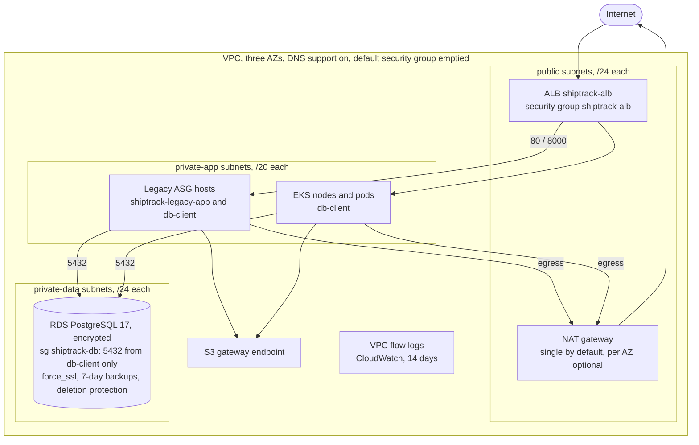

#### Shared services

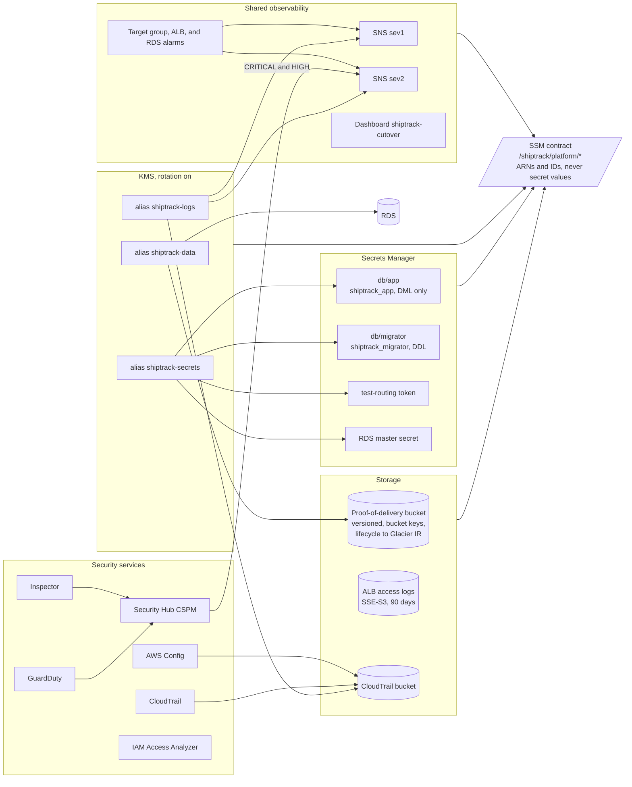

#### Bootstrap and pipeline roles

Nothing is applied from a workstation. The OIDC provider, the seed role, and the GitHub
environments are made by hand once. `apply-bootstrap` then creates the state bucket, the permission
boundary, and the nine roles that every other workflow assumes.

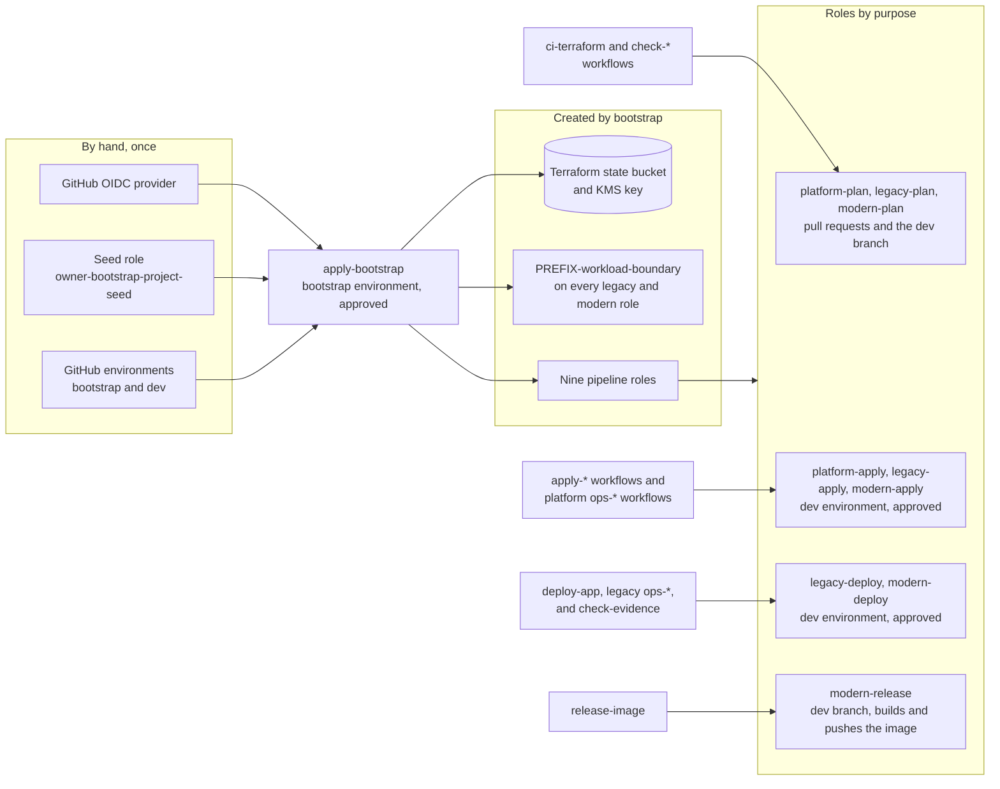

### shiptrack-legacy

The anti-patterns are requirements, tagged in code as `LEGACY AP-xx`. Each one is fixed by the
matching `REM-xx` in `shiptrack-modern`.

#### One host

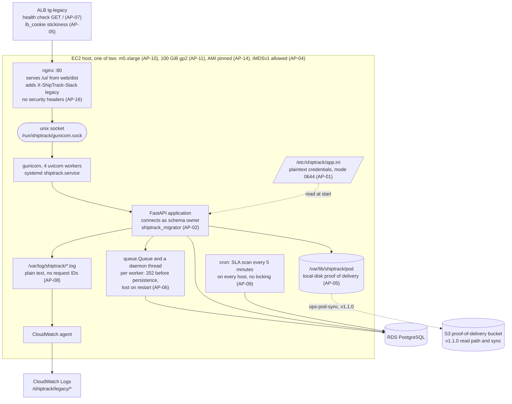

#### Infrastructure around the hosts

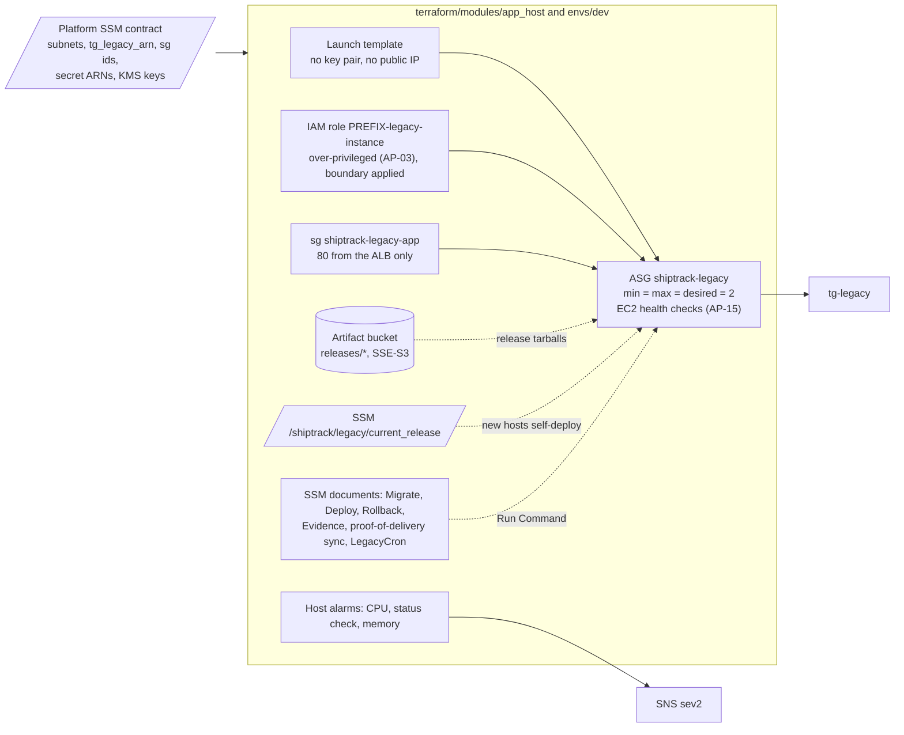

#### Deploying a release

`deploy-app` never runs Terraform and Terraform never writes `current_release`. A deploy
restarts each host in place without leaving the target group (AP-12), and the database is not
rolled back.

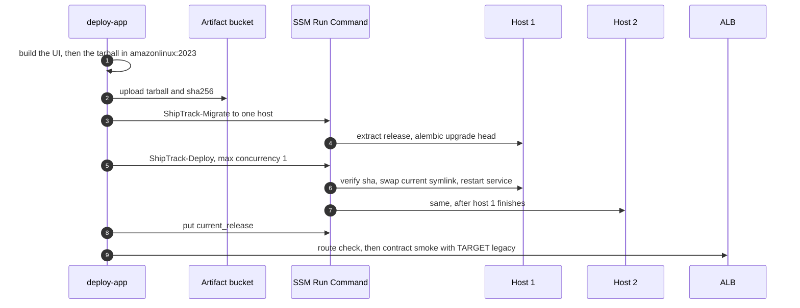

### shiptrack-modern

#### In the cluster

One image runs five roles through `python -m shiptrack <role>`. Each service account has its own
Pod Identity role, named `PREFIX-modern-*` and carrying the platform boundary.

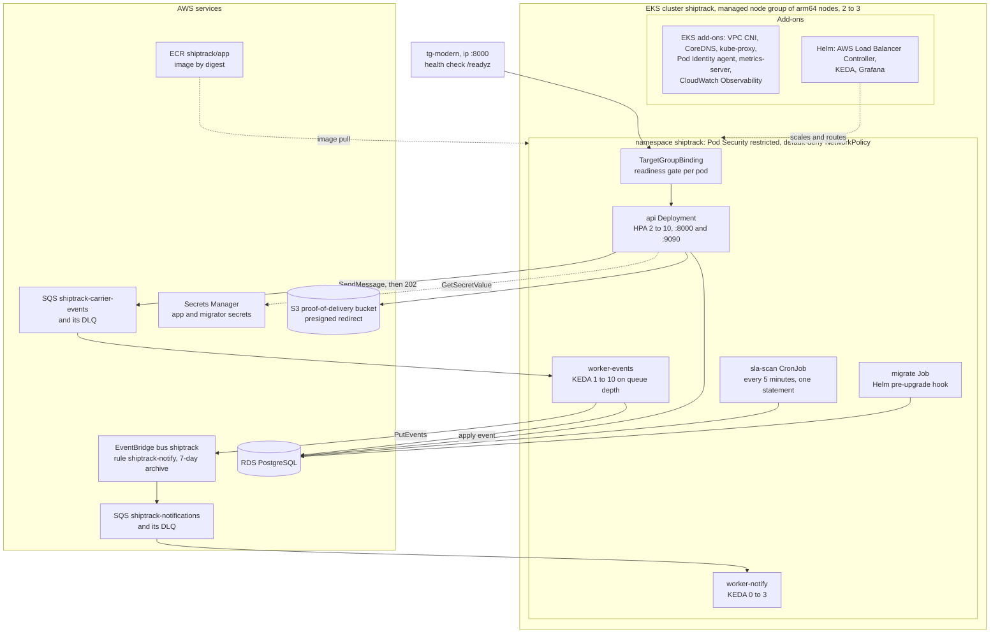

#### The UI in the browser

The UI is a single-page app that the `api` pods serve under `/ui/`. It calls only the public API, and
one runtime above the router is shared by every page. Legacy's UI is a separate, minimal tracking page
served by nginx and is not changed.

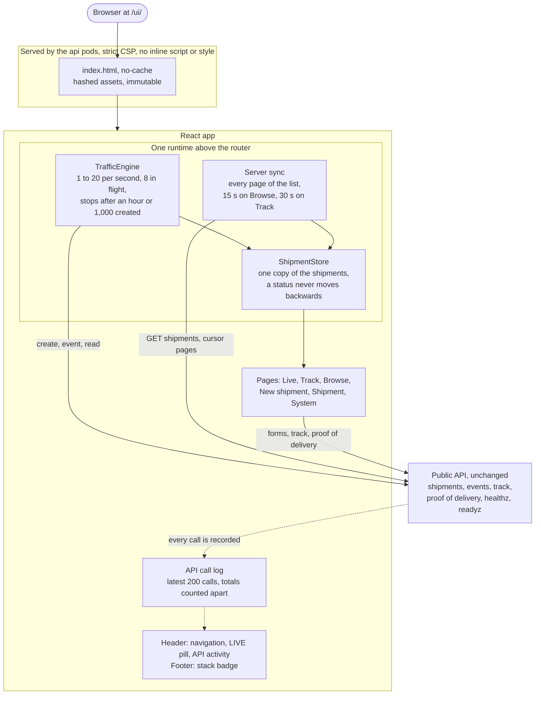

#### Event ingestion, before and after

Legacy answers `202` before the event is stored, so a restart loses what is in the queue (AP-06).
Modern answers `202` once SQS holds the event, and a worker applies it later (REM-06).

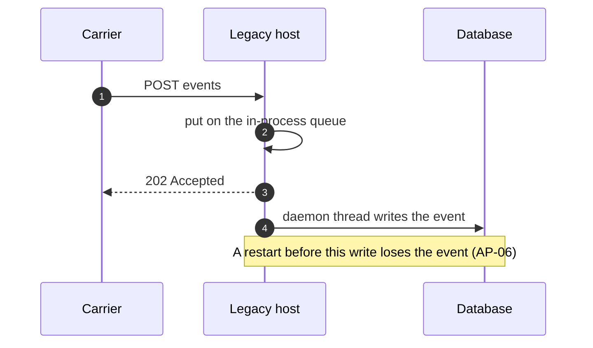

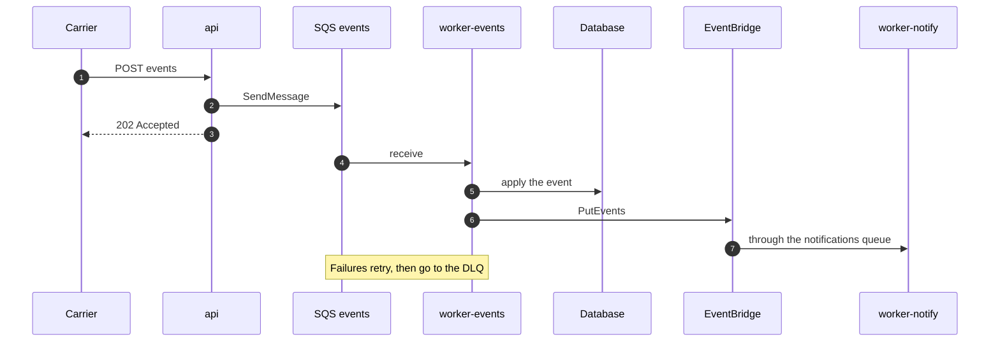

#### Observability

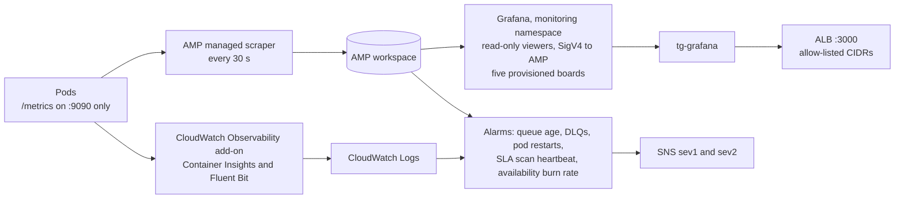

#### Delivery

`release-image` hands the digest to `deploy-app`, which renders Helm values from SSM, upgrades with
`--atomic`, smoke-tests through the ALB with the platform's contract suite, and rolls back if the
smoke fails. Terraform runs as two roots, `cluster` then `addons`, after one approval.

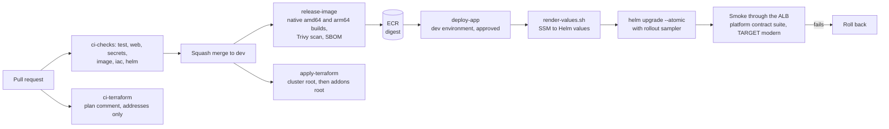

## Status

| Phase | State |
|---|---|
| L1 Application, L1b Web UI | Done; tagged `v1.0.0` |
| L2 Packaging | Done: `deploy/`, `scripts/`, `tests/packaging/` |
| L3 Terraform | Done and applied: `terraform/envs/dev`, `terraform/modules/app_host` |
| L4 CI/CD | Done and in use (workflows below) |
| L5 Assessment tooling | Partly: `check-evidence.yml` and the `ShipTrack-Evidence` document (the G-POD gate, AP-09 duplicates, and the ledger check) are built (ADR-0004). Not started: `assess.yml`, the assessment reports, and the anti-pattern evidence procedures |
| L6 v1.1.0 | Done: deployed and tagged `v1.1.0`. The S3 read path, `scripts/migrate_pod_to_s3.py`, the `ShipTrack-PodSync` document and `ops-pod-sync.yml`, and the data-key grant (ADR-0002, ADR-0003). Required before cutover wave 2 |

Modern serves all traffic. Legacy is kept running as a fallback and nothing is destroyed: its UI
is on the platform's preview port, for the addresses that port allows (platform ADR-0032). It is the original minimal tracking page (search, status, and event timeline) and is not changed; modern's UI is a larger app of its own (see the `shiptrack-modern` README). Its SLA
and sync cron jobs are removed (`ops-legacy-cron.yml`, `ops-pod-sync.yml`), so it does not scan or sync.
To fall back to it, suspend modern's SLA CronJob before restoring legacy's cron.
`ops-simulate-events.yml` has seeded the stack with shipments, events, and proof-of-delivery files.
Clearing them is the platform's `ops-reset-data` (platform ADR-0034): it runs the `ShipTrack-ResetData`
document on these hosts one at a time, because they can reach the private database.

## Layout

| Path | What it holds |
|---|---|
| `src/shiptrack/` | The API: FastAPI, SQLAlchemy, an in-process event queue, local-disk proof-of-delivery storage |
| `migrations/` | Alembic |
| `web/` | The React UI; `web/.nvmrc` pins Node |
| `deploy/` | systemd, nginx, cron, logrotate, and CloudWatch agent configuration |
| `scripts/` | Build, deploy, migrate, rollback, and database bootstrap scripts that run on the hosts |
| `terraform/` | `modules/app_host` (launch template, ASG, instance profile) and `envs/dev` |
| `tests/` | Unit and integration tests, packaging tests on `amazonlinux:2023`, and tests of the workflow scripts |

## Pipelines

Nothing is applied from a workstation. Every AWS change is a workflow that assumes an OIDC role,
and the `dev` environment requires a reviewer.

| Workflow | Runs | Does |
|---|---|---|
| `ci-checks.yml` | pull requests | Lint, types, tests with a 75% coverage gate, Terraform format and validate, UI checks, and a packaging test |
| `ci-terraform.yml` | pull requests touching Terraform | Format, validate, and a plan comment with addresses and actions only |
| `apply-terraform.yml` | push to `dev`, or by hand | Plans and applies `terraform/envs/dev` after approval |
| `ops-db-bootstrap.yml` | by hand | Creates the database, roles, and schema from a legacy host (ADR-0011) |
| `deploy-app.yml` | push to `dev` that changes the app, or by hand | Builds the tarball, migrates, deploys to each host in turn, records the release, waits for the ALB to serve the stack, and runs the platform contract suite's `smoke` subset against it (`platform_ref` picks the platform commit; default `dev`) |
| `ops-rollback-release.yml` | by hand | Points the hosts back at the previous release; the database is not rolled back |
| `ops-simulate-events.yml` | by hand | Runs the platform's carrier event simulator against the live stack; `target` is `legacy` (pinned), `modern` (pinned), or `none` (the ALB's weights, which covers both stacks during a cutover) |
| `ops-legacy-cron.yml` | by hand | Cutover wave 3: reports on, removes (`remove-sla`), or restores the SLA scan cron on each legacy host, one at a time. One line of words per host |
| `check-evidence.yml` | by hand | Runs one read-only check on a host against the private database: `pod-gate` (cutover gate G-POD), `sla-duplicates`, or `ledger-verify`. Shows one line of numbers |
| `ops-pod-sync.yml` | by hand | v1.1.0: moves each host's proof-of-delivery files to S3 (`dry-run`, `migrate`), and installs or removes the per-minute sync (`install-cron`, `remove-cron`). One host at a time |

First run, in order: `apply-terraform`, then `ops-db-bootstrap`, then `deploy-app`. The URL is the platform
ALB's, from the `base_url` SSM parameter; it is not written in this repository.

### Workflow names

A workflow file is `<category>-<what>.yml`, and its `name:` is the file name without `.yml`, so the
Actions list sorts by what a workflow does.

| Prefix | Does | Runs on | Needs approval |
|---|---|---|---|
| `ci-` | Checks a pull request. Changes nothing in AWS | pull request | No |
| `apply-` | Applies Terraform | push to `dev`, or by hand | `dev` environment |
| `release-` | Builds an artifact and pushes it | push to `dev`, or by hand | No |
| `deploy-` | Puts a release on the running stack | after a release, or by hand | `dev` environment |
| `ops-` | One operation on a running system: rollback, unlock, cron, database | by hand | `dev` environment |
| `check-` | Reads state or judges evidence. Changes nothing | by hand, or a schedule | No, except `check-evidence`, which runs on a host (`dev` environment) |

## Local development

Requires Python 3.12, [uv](https://docs.astral.sh/uv/), and Docker (OrbStack works).

```sh
make venv        # virtualenv with hash-pinned dependencies
make up          # Postgres 17 on localhost:5432
make check       # ruff, mypy, and tests with the coverage gate
```

Tests create and drop their own throwaway databases on the Postgres from `make up`. Set
`SHIPTRACK_TEST_DATABASE_URL` to use a different server.

To run the API by hand, write an INI file (see `src/shiptrack/config.py` for the keys), point
`SHIPTRACK_CONFIG` at it, then:

```sh
make migrate
.venv/bin/python -m gunicorn shiptrack.main:app -k uvicorn_worker.UvicornWorker -b 127.0.0.1:8000
```

The UI lives in `web/` and needs the Node version in `web/.nvmrc`:

```sh
make ui-install  # npm ci
make ui-check    # lint, typecheck, tests, build, and the dist checks
```

Dependencies are compiled with `pip-compile --generate-hashes` from `requirements.in` and
`requirements-dev.in`.
